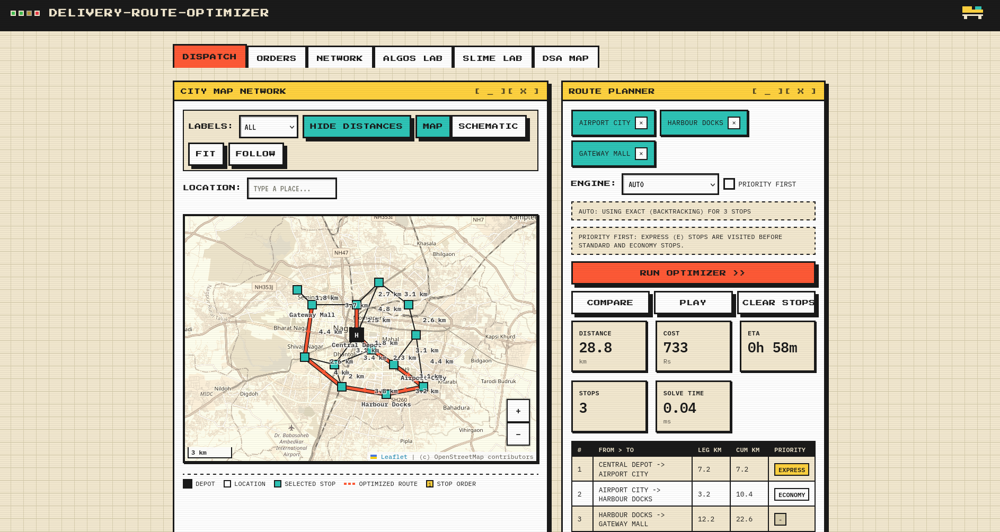

# Delivery-Route-Optimizer

A small Flask app that runs a delivery service on a made-up city: queue orders,
assign drivers, plan routes, and watch the algorithms work on a real map.
Built for our DSA course — every data structure is hand-written, nothing comes
from a library beyond Flask itself.

The interesting bit: routes are planned with classic search (exact + heuristic),
and there's also a slime-mold solver (Physarum, Tero et al. 2010) that "grows"
its answer tube by tube. Dijkstra stays as the referee.

