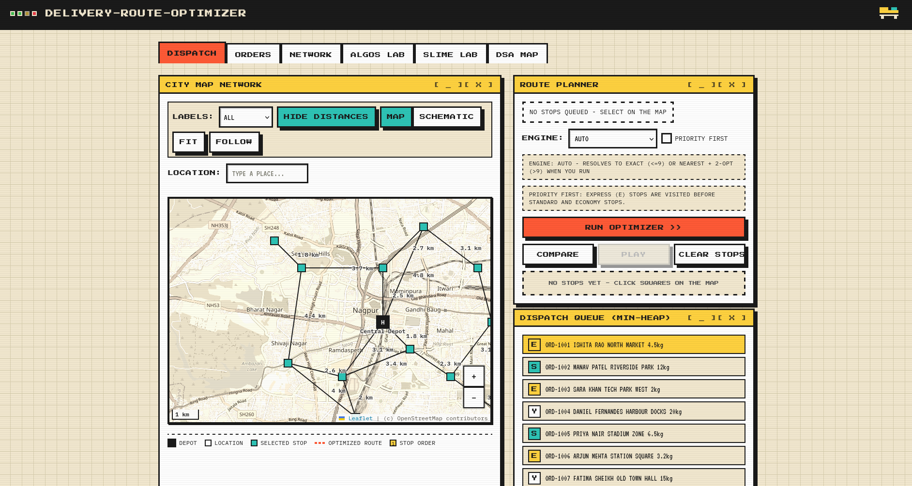
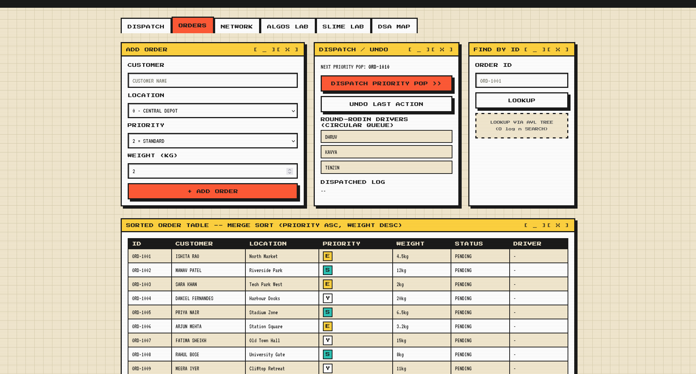
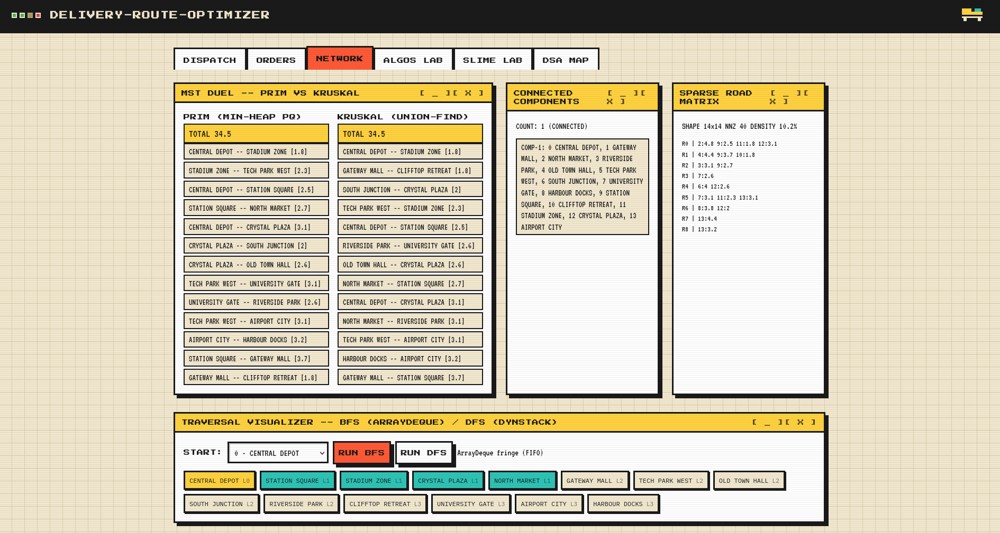
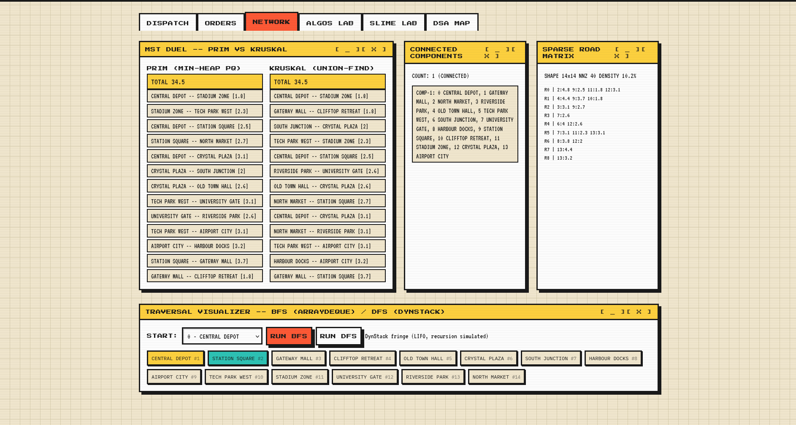
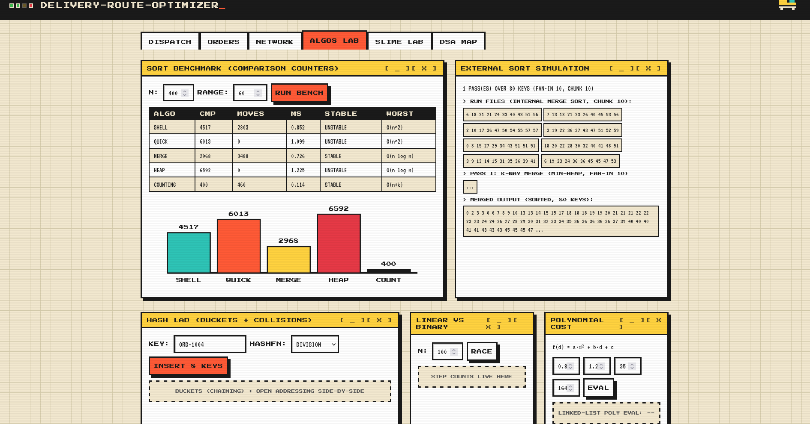
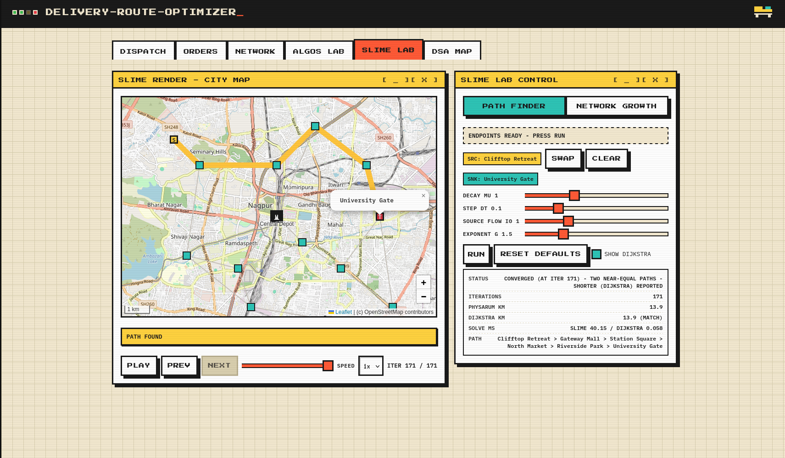
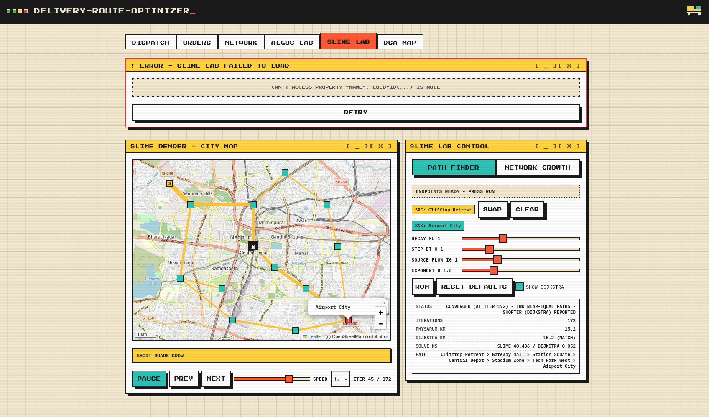

# Delivery-Route-Optimizer

A small Flask app that runs a delivery service on a made-up city: queue orders,
assign drivers, plan routes, and watch the algorithms work on a real map.
Built for our DSA course — every data structure is hand-written, nothing comes
from a library beyond Flask itself.

The interesting bit: routes are planned with classic search (exact + heuristic),
and there's also a slime-mold solver (Physarum, Tero et al. 2010) that "grows"
its answer tube by tube. Dijkstra stays as the referee.


## Running it

```bash
python3 -m venv venv
source venv/bin/activate
pip install -r requirements.txt
python app.py            # http://127.0.0.1:5000
```

Tests:

```bash
python -m unittest discover tests     # 92 tests
python verify-map.py                  # 72 checks against a running server
```

Requires Python 3.10+. Map tiles come from OpenStreetMap/CARTO (no API keys);
without internet the app falls back to a hand-drawn SVG map.

## The six tabs

**DISPATCH** — pick stops on the map (or through the autocomplete box), then
solve the tour. The exact planner is stack-based backtracking with
branch-and-bound pruning (caps at 9 stops), the heuristic one is
nearest-neighbour + 2-opt. The result animates over the city, and the side
panel shows the pending orders min-heap. The cost model is a polynomial the
course kept asking about, so it's evaluated with a linked list, on purpose.



**ORDERS** — add orders with priority and weight; dispatch pops the heap and
hands them to drivers on a round-robin ring. Order lookup goes through an AVL
tree (it reports search-step counts), the same index is duplicated as a B-tree
and range-scanned by a B+ tree, and the table is kept sorted with merge sort.



**NETWORK** — connected components via union-find, and a Prim-vs-Kruskal MST
duel (own min-heap vs union-find; both agree, 34.5 km on the seed graph). BFS
and DFS visualizers show visit order from any node, and the sparse road matrix
is stored in linked-row form with its density spelled out.





**ALGOS LAB** — a bench for the sorting zoo (shell/quick/merge/heap/counting)
with comparison and move counters, plus an external-sort simulation (chunked
runs merged through the min-heap), a chaining-vs-open-addressing hash lab with
three hash functions, and a linear-vs-binary search race.



**SLIME LAB** — the Physarum solver. Click two nodes, press run, and watch
road conductance adapt (`D += dt·(|Q|^g/(1+|Q|^g) − μD`) under a conjugate
gradient solving the pressure system each iteration — all hand-written, no
numpy. The solve returns up to 90 log-spaced frames so the animation has a
real timeline, and Dijkstra's path is drawn as a dashed overlay for
comparison. There's also a "network growth" mode that re-runs the Tokyo-rail
experiment on your selected stops and prunes the result against Kruskal's MST.





**DSA MAP** — a plain viewer for the raw structures (graph adjacency, heap
array, trie) without the delivery layer on top.

One note on honesty: the slime solver is bio-inspired and *heuristic*. It
usually agrees with Dijkstra (and the UI says so when it does), but if it
misses, the Dijkstra path is what ships. Every solve reports both.


## The map

Two engines render the same graph: a hand-drawn SVG schematic (cream grid,
squares for locations) and a Leaflet map with OSM/CARTO tiles. You can switch
any time; labels, distances and route styling follow. Five consecutive tile
errors swap the Leaflet view back to the schematic on its own. Clicking empty
ground on the real map opens a popup to add a location there, connected to
its three nearest neighbours.
